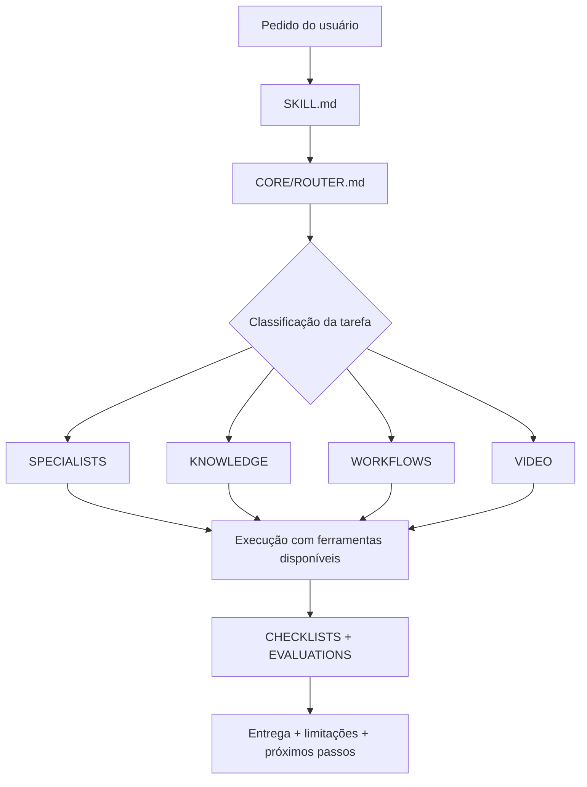

<div align="center">



### 🧠 Um sistema modular de engenharia para agentes de IA

**Engenharia reversa · Software · Android · APIs · Segurança · Web cinematográfica · Vídeo · Pesquisa · QA**

[](CHANGELOG.md)
[](LICENSE)
[](https://github.com/LLGGJ/engineering-creative-ai/actions/workflows/validate.yml)
[](https://github.com/LLGGJ/engineering-creative-ai/actions/workflows/build-landing-page.yml)

**Uma base modular de conhecimento, processos e ferramentas para transformar tarefas técnicas complexas em entregas verificáveis.**

🧭 [Começar](#-início-rápido) · 🏗️ [Arquitetura](#-arquitetura) · 🧩 [Módulos](#-módulos) · 💬 [Exemplos](#-exemplos-de-pedidos) · 🎬 [Portal](#-portal-visual) · 🤝 [Contribuir](CONTRIBUTING.md)

</div>

---

> [!IMPORTANT]
> Esta é uma **Skill/base de conhecimento**, não um modelo treinado, IDE ou agente autônomo por si só. Ela orienta um modelo compatível a escolher procedimentos, consultar módulos e agir com evidência.

## ✨ Visão geral

| Ícone | Área         | O que o projeto entrega                                              |
| ----- | ------------ | -------------------------------------------------------------------- |
| ⚡    | Execução     | Roteamento rápido, execução direta e validação proporcional ao risco |
| 🧠    | Conhecimento | Especialistas, workflows, playbooks e referências por domínio        |
| 🛡️    | Segurança    | Regras de autorização, preservação de dados e uso responsável        |
| 🎨    | UX e web     | Direção visual, interfaces, landing pages e experiência digital      |
| 🎬    | Vídeo        | Pipeline, roteiro, render, edição e QA audiovisual                   |
| 🔎    | Pesquisa     | Fontes, análise, comparação técnica e contexto comercial             |

### Política de execução direta

A skill prioriza executar a tarefa real quando o ambiente, autorização e ferramentas estiverem disponíveis. Prompts são uma exceção e não o comportamento padrão.

### Template de entrega recomendada

- 🎯 objetivo e contexto
- 🧰 ambiente, ferramentas e permissões
- ⚠️ premissas e limitações
- ✅ ação executada ou pendente
- 📌 evidência e validação
- 🚀 riscos, autorização e próximos passos

Use este padrão para tarefas simples e complexas, para reduzir ambiguidades e evitar afirmações sem prova.

---

## 🧩 O que é

Engineering Creative AI é um sistema modular para Claude e outros agentes que aceitem instruções e arquivos de conhecimento. O núcleo roteia cada tarefa para especialistas e workflows específicos, reduzindo leitura desnecessária e mantendo um padrão de qualidade, segurança e honestidade.

### Capacidades cobertas

- **🔐 Engenharia reversa autorizada:** inspeção estática/dinâmica, APKs, binários, formatos, protocolos e análise de comportamento.
- **💻 Engenharia de software:** arquitetura, implementação, debugging, refatoração, testes e documentação.
- **📱 Android:** Kotlin, Java, Gradle, APK/AAB, ciclo de vida e publicação.
- **🔌 APIs e integrações:** contratos, autenticação, HTTP, webhooks, SDKs e diagnóstico.
- **🛡️ Segurança defensiva:** modelagem de ameaças, auditoria e mitigação.
- **🎨 Web cinematográfica:** direção visual, interfaces 3D, performance, acessibilidade e prompts de implementação.
- **🖼️ Imagem e visão:** análise visual, edição, comparação de arte e processamento de conteúdo visual com preservação do original.
- **📄 Documentos e PDFs:** extração, resumo, OCR, comparação e QA documental.
- **🎬 Vídeo:** criação do zero, geração por IA, Blender, animação por código, edição de footage, áudio, legendas, FFmpeg e QA.
- **🔎 Pesquisa e inteligência:** fontes, comparação técnica, análise de repositórios e inteligência comercial baseada em evidências.
- **✅ Qualidade:** checklists, gates, casos de teste e validação reproduzível.

---

## ⚡ Início rápido

1. 📦 Baixe o ZIP desta versão ou clone o repositório.
2. 📖 Leia `SKILL.md` e `CORE/ROUTER.md`.
3. 🛠️ Instale/import a Skill conforme o ambiente e a documentação atual do cliente.
4. 🔌 Conecte separadamente as ferramentas que o agente realmente usará.
5. 🧪 Peça uma tarefa pequena e valide se o agente seleciona os módulos corretos.

### Claude Code (exemplo de instalação local)

```bash
mkdir -p .claude/skills
cp -R engineering-creative-ai-v3.0.3 .claude/skills/engineering-creative-ai
```

Se já estiver dentro do repositório da Skill, copie a pasta para `.claude/skills/engineering-creative-ai/`. Para uso global, consulte a documentação atual do Claude Code sobre diretórios de Skills. O caminho e o método de importação podem variar entre produtos e versões.

### Uso inicial sugerido

```text
Leia SKILL.md e CORE/ROUTER.md. Analise minha tarefa, escolha apenas os módulos necessários,
faça um plano curto, execute o que estiver dentro das ferramentas disponíveis e valide o resultado.
Separe fatos verificados, hipóteses e pontos não verificados. Não invente testes nem resultados.
```

---

## 💬 Exemplos de pedidos

| Você pede | A skill tende a… |
| --- | --- |
| 🐛 "Esse endpoint retorna 500 às vezes, investiga" | 🔌 Carregar `API-INTELLIGENCE` e `SOFTWARE-ENGINEERING`, reproduzir e separar hipótese de fato |
| 🌐 "Monta uma landing page com scroll animado" | 🎨 Carregar `CINEMATIC-WEB-DESIGN`, validar acessibilidade e `prefers-reduced-motion` |
| 🔐 "Audita as permissões desse backend" | 🛡️ Carregar `SECURITY-AUDIT` e pedir autorização antes de qualquer teste ativo |
| 🎞️ "Faz um roteiro de Shorts de 45 segundos" | 🎬 Carregar `VIDEO-FROM-ZERO` e entregar roteiro, storyboard e checklist de QA |
| 📄 "Resume esse PDF e compara com o anexo" | 📑 Carregar `DOCUMENT-PROCESSING` e citar onde cada ponto aparece |

> [!TIP]
> Dê o contexto, o ambiente disponível e o resultado esperado. Quanto mais claro o pedido, menos módulos a skill precisa abrir.

> [!WARNING]
> A skill não concede permissões nem instala programas. Ações externas, publicações e dados sensíveis exigem autorização explícita.

---

## 🧭 Arquitetura



---

## 🧩 Módulos

| Diretório             | Responsabilidade                                                          |
| --------------------- | ------------------------------------------------------------------------- |
| `CORE/`               | Roteamento, operação, memória, conectores, tokens e autoria de Skills.    |
| `SPECIALISTS/`        | Especialistas por domínio técnico.                                        |
| `KNOWLEDGE/`          | Fundamentos e playbooks reutilizáveis.                                    |
| `WORKFLOWS/`          | Processos passo a passo e entregáveis, incluindo imagem, documentos e QA. |
| `VIDEO/`              | Pipeline audiovisual completo.                                            |
| `PROMPTS/`            | Briefings e prompts estruturados.                                         |
| `CHECKLISTS/`         | Segurança, testes, release e qualidade.                                   |
| `EVALUATIONS/`        | Casos de teste, gates e scorecards.                                       |
| `TOOLS/`              | Utilitários e instruções de ferramentas.                                  |
| `REFERENCES/`         | Fontes oficiais e referências externas.                                   |
| `docs/`               | Arquitetura, governança e manutenção.                                     |
| `portal/`             | Página de apresentação estática com animações acessíveis.                 |
| `scripts/` e `tests/` | Validação automatizada do pacote.                                         |
| `ARCHIVE/`            | Cópias preservadas das bases anteriores. Não usar como fonte primária.    |

---

## 🎬 Portal visual

O diretório `portal/` contém uma página estática independente com identidade visual cinematográfica, efeitos leves, animação de partículas, elementos 3D em CSS e suporte a `prefers-reduced-motion`. Ela pode ser publicada via GitHub Pages. O README do GitHub não executa JavaScript livremente; por isso os efeitos ficam no portal, não embutidos no Markdown.

Para testar localmente:

```bash
python -m http.server 8000 --directory portal
```

Abra `http://localhost:8000`.

---

## 🧪 Validação local

Requer Python 3.10+ (somente biblioteca padrão para os testes do pacote):

```bash
python scripts/validate_package.py
python -m unittest discover -s tests -v
```

A validação verifica manifesto, arquivos declarados, links locais essenciais e metadados básicos. Ela **não** comprova que todos os procedimentos técnicos funcionam em todos os ambientes.

---

## 🛡️ Segurança e uso responsável

Use engenharia reversa e auditoria apenas em sistemas próprios ou com autorização explícita. Não use este pacote para roubar credenciais, desenvolver malware, invadir terceiros, exfiltrar dados ou contornar controles de acesso. Não armazene tokens, senhas ou dados pessoais em arquivos do projeto.

---

## ♻️ Política de evolução aditiva

A partir da versão 3.0.3, a estrutura é tratada como contrato público:

1. **🚫 Não apagar nem renomear** arquivos/pastas publicados.
2. **✨ Preferir** adicionar novos módulos, exemplos e versões.
3. **🗂️ Manter** o anterior em `ARCHIVE/` e registrar a migração.
4. **🧭 Não reutilizar** um caminho antigo para um assunto incompatível.
5. **📦 Atualizar** `PACKAGE-MANIFEST.json`, `CHANGELOG.md`, testes e documentação na mesma alteração.
6. **📌 Marcar** conteúdo obsoleto como `DEPRECATED` e apontar o sucessor; não remover.
7. **🧪 Exigir** novas versões principais ou plano de migração para mudanças incompatíveis.

Veja `docs/ADDITIVE-STRUCTURE-POLICY.md`, `docs/MODULE-MIGRATION-MAP.md` e `docs/RELEASE-AND-VERSIONING.md`.

---

## 🗺️ Roadmap

Consulte [ROADMAP.md](ROADMAP.md). Itens futuros são propostas, não funcionalidades já implementadas.

---

## 🤝 Contribuição

Leia [CONTRIBUTING.md](CONTRIBUTING.md), [CODE_OF_CONDUCT.md](CODE_OF_CONDUCT.md) e os templates em `.github/ISSUE_TEMPLATE/`.

---

## 📄 Licença

MIT para os materiais originais deste repositório. Referências e ferramentas de terceiros mantêm suas próprias licenças e termos. Consulte [LICENSE](LICENSE).

<div align="center">

**Engineering Creative AI · 3.0.3**  
_Build carefully. Verify everything. Preserve what works._

</div>
